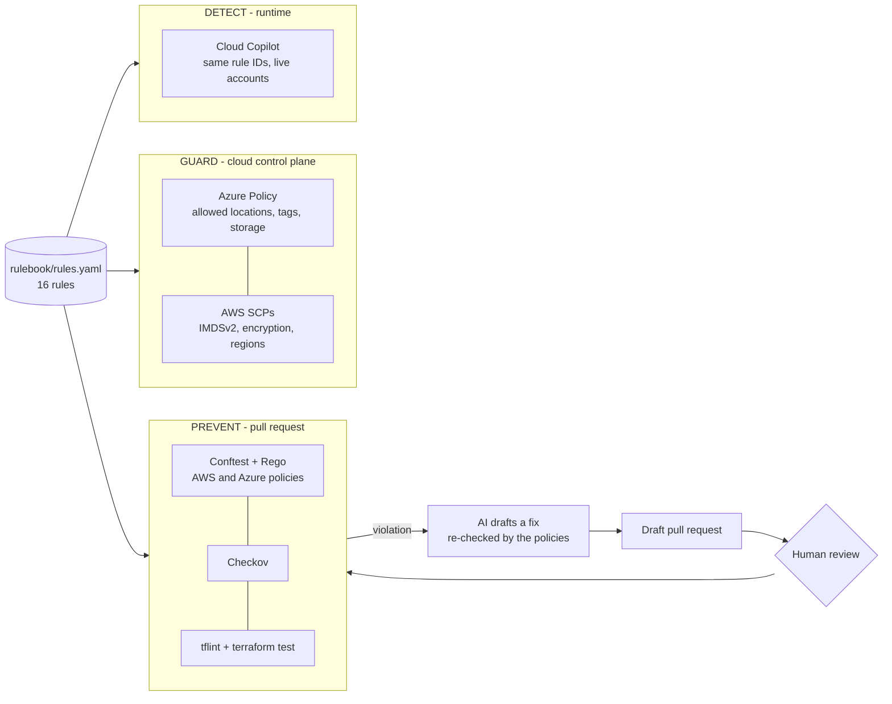

# Multi-Cloud Guardrail Platform


A secure **landing zone for AWS and Azure**, written in Terraform, where **one rulebook is enforced three times**:
before deployment (in the pull request), at the cloud API (Azure Policy and AWS SCPs) and at runtime
([Cloud Copilot](https://github.com/raeeed08/cloud-copilot) scans the live accounts with the same rule IDs). When a policy fails,
an AI drafts the fix; the fix must pass the same guardrails, and a human always approves it.



## Why it matters

Most cloud breaches come from misconfiguration, not from the provider. Teams usually pick **one** control point:
scan the code in CI, or block at the API with organisation policies, or scan the running cloud. Each misses
something: code scanners cannot see the console, API guardrails cannot see intent, runtime scanners see problems
only once they exist. This project wires the three together around a single rulebook, so every rule ID means the
same thing in a pull request comment, an Azure Policy denial and a runtime finding.

## What is inside

| Area | What it does |
|---|---|
| **Rulebook** | 16 rules (network, storage, encryption, keys, databases, identity, logging, compute, tags, regions) with why / how to fix, CIS and NIST mapping and the matching Cloud Copilot rule IDs. [docs/rules.md](docs/rules.md) is generated from it. |
| **Policies** | Rego for AWS and Azure on top of a shared library, run with Conftest. Variables are treated as unknown, not as failures, and are checked at runtime instead. |
| **Policy tests** | Insecure and safe cases with one `# expect: RULE-ID` per violation; caught must equal expected for every rule (no miss, no false positive). |
| **Azure landing zone** | VNet with default-deny NSGs, private storage (no public containers, no shared keys, TLS 1.2), Key Vault (RBAC, purge protection, private endpoint), Log Analytics + Activity Log + security alerts, Azure Policy guardrails, Defender plans, GitHub OIDC identity. |
| **AWS landing zone** | VPC with flow logs, a locked default security group and an S3 gateway endpoint; KMS with rotation; secure S3 (TLS-only policy, Block Public Access, versioning, lifecycle); multi-region CloudTrail with validation, KMS and a tampering alarm; account baseline (S3/EBS/snapshot safety nets, IMDSv2 default, GuardDuty, Access Analyzer, password policy); GitHub OIDC role; organisation SCPs. |
| **Tests** | `terraform test` for all 13 modules with mock providers (31 runs, no cloud account needed), variable validations and preconditions (for example, SCP size against the 5,120-character limit). |
| **CI/CD** | Pull requests run fmt, rulebook, tflint, validate + tests, policy tests, a self-check (the landing zone passes its own rules), Checkov (results in the GitHub Security tab) and gitleaks. Deployment uses OIDC (no stored cloud secret), a reviewed plan and an approval gate. Dependabot, pre-commit. |
| **AI fix loop** | `tools/ai_fix.py`: violations + rulebook guidance go to an LLM; its answer is accepted only if the violated rules are gone, no new rule fails and `terraform fmt` accepts it; output is a diff or a **draft** pull request. |

## Status

| Part | Status |
|---|---|
| Rulebook, AWS + Azure policies, policy tests | Done: 28 rule/cloud pairs proven by fixtures |
| Azure and AWS modules, environments | Done: validated, tflint clean, Checkov 282 passed / 0 failed (22 documented skips) |
| Module tests | Done: 13 modules, 31 `terraform test` runs |
| CI pipeline, deploy workflow | Done: actionlint clean; deploy needs the cloud identities to exist (bootstrap below) |
| AI fix loop | Done: unit-tested with fakes, integration-tested with the real policies; live LLM call needs an API key |
| Live deployment | **Not yet**: everything is verified statically and with mocks; no cloud account was used |

## Quick start

Requirements: Terraform 1.7+, Docker, and [uv](https://docs.astral.sh/uv/) (or Python 3.11+ with PyYAML).

```bash
make check                      # everything CI runs, in the same order
make policy                     # prove each policy catches exactly the insecure fixtures
make conftest P=envs/aws-dev    # run the policies on any Terraform
make test                       # validate environments, terraform test every module
make help                       # all targets
```

Try a violation: add `cidr_blocks = ["0.0.0.0/0"]` on port 22 to any security group and run `make conftest P=<file>`.
Then let the AI draft the fix (dry run, prints a diff):

```bash
export AI_API_KEY=...           # any OpenAI-compatible API; Groq by default
make ai-fix P=path/to/file.tf
```

## Deploying

1. **State**: create a state bucket / storage account once (see `envs/*/backend.hcl.example`).
2. **Bootstrap** (once, as an administrator): `terraform init -backend-config=backend.hcl && terraform apply` in
   `envs/azure-dev` and `envs/aws-dev`. This creates, among the rest, the OIDC identity GitHub will use.
3. **GitHub**: create environments `dev` and `dev-apply` (with required reviewers) and set the variables listed at
   the top of [.github/workflows/deploy.yml](.github/workflows/deploy.yml). No secret is needed.
4. From then on: **Actions → deploy → plan** (or **apply**, which waits for approval of the reviewed plan).
5. SCPs (`envs/aws-org`) are applied from the AWS Organizations management account, on a sandbox OU first.

Costs: the defaults avoid paid extras (no NAT gateway, no Defender plans, no Security Hub, LRS storage in dev).
GuardDuty and log ingestion are the main running costs; `terraform destroy` removes everything except the
soft-deleted Key Vault (purge protection) and KMS keys (30-day deletion window), by design.

## Repository layout

```
rulebook/rules.yaml        the single source of truth (16 rules)
policies/lib|aws|azure     Rego: shared helpers + per-cloud policies (Conftest)
tests/fixtures/aws|azure   insecure and safe cases with "# expect: RULE-ID"
modules/aws/*              network, kms, s3-secure-bucket, cloudtrail, security-baseline, github-oidc, org-guardrails
modules/azure/*            network, storage, keyvault, monitoring, governance, github-oidc
modules/*/*/tests          terraform test files (mock providers)
envs/                      azure-dev, aws-dev, aws-org root configurations
scripts/                   check.sh, test_policies.py, rulebook.py, tf_test.sh, tflint.sh
tools/ai_fix.py            AI-drafted, policy-validated, human-approved fixes
docs/                      rules.md (generated), architecture.md, course/ (zero to hero)
```

## Design principles

- **One rule ID everywhere**: a finding means the same thing in a PR, a policy denial and a runtime scan.
- **Secure by default, cheap by default**: safe settings need no flag; paid features are opt-in and documented.
- **Prove, don't claim**: every policy has fixtures that must be caught exactly; every module has tests.
- **No standing secrets**: CI uses OIDC federation on both clouds; humans use roles and managed identities.
- **AI proposes, policies verify, humans decide**: an LLM never applies anything.
- **Honest limits**: policies read code, where variables are unresolved; runtime detection covers deployed values.

## Learn it

[docs/course/](docs/course/README.md) explains every concept and tool from zero (Terraform, landing zones, OPA/Rego,
Checkov, Azure Policy, SCPs, OIDC, testing infrastructure) with the commands and the interview questions.
