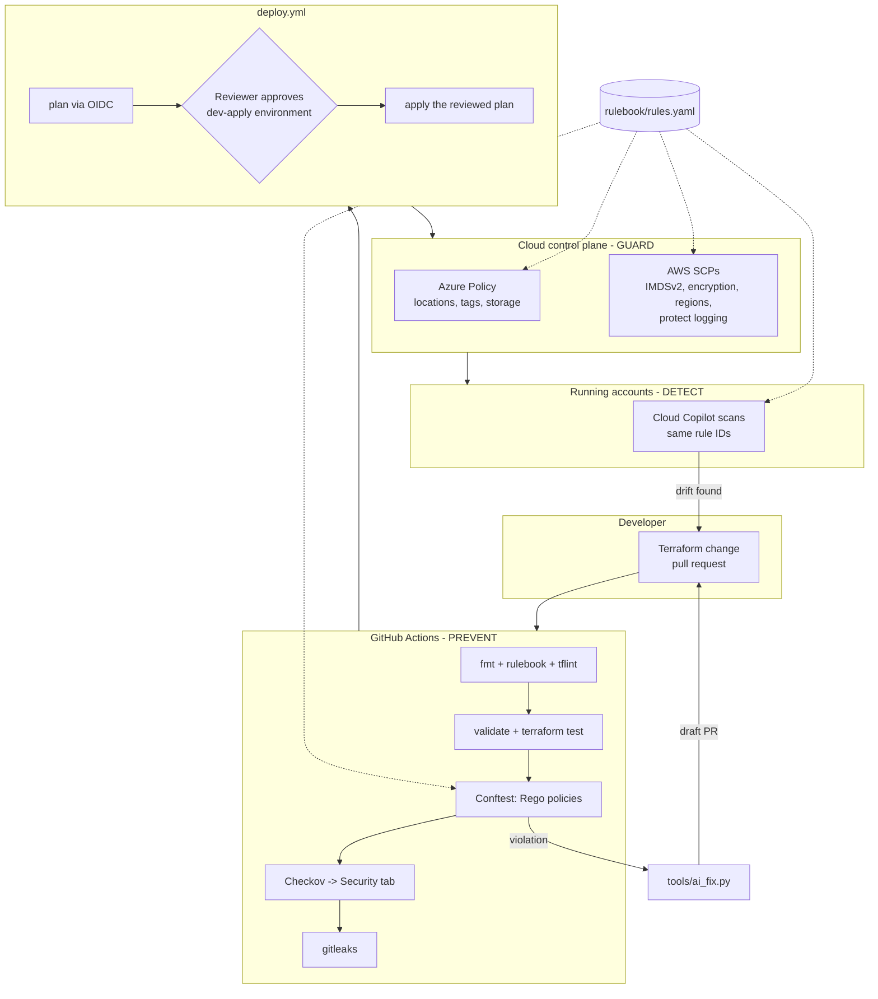
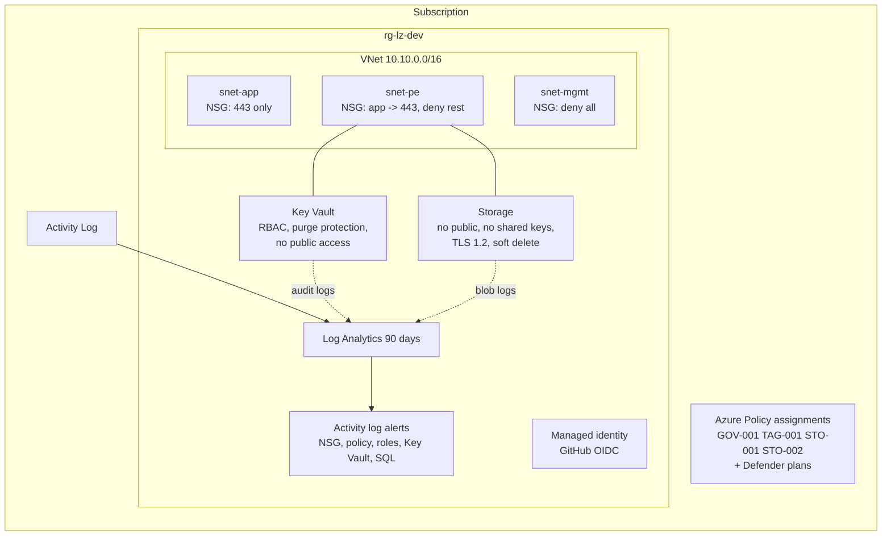
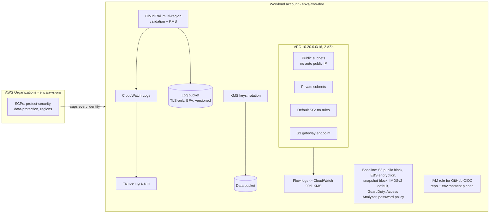

# Architecture

## Three enforcement points, one rulebook

| Layer | Sees | Cannot see | Implemented by |
|---|---|---|---|
| Prevent | Intent, before anything exists | Values only known at deploy time; console changes | Conftest/Rego, Checkov, tflint, `terraform test` |
| Guard | Every API call, whatever the tool | Why the change was made; already-existing resources (audit only) | Azure Policy assignments, AWS SCPs, account baselines |
| Detect | The real, current state | Changes before they happen | Cloud Copilot (runtime scanner) |

## Azure landing zone (`envs/azure-dev`)

## AWS landing zone (`envs/aws-dev`, `envs/aws-org`)

## Why some choices were made

- **Rego reads HCL, not the plan.** It runs on every pull request in seconds without cloud credentials. The price:
  values coming from variables are unknown. Policies give them the benefit of the doubt (no false positive) and
  the runtime layer catches the deployed value. Policies on `terraform show -json` plans are the next step once
  a plan exists in CI.
- **Conftest + custom Rego and Checkov.** Checkov brings ~1,000 generic checks; the custom policies encode *our*
  rulebook with *our* rule IDs and messages, which is what ties the three layers together.
- **Mock providers for tests.** Real assertions on the plan of every module without credentials or cost. The
  trade-off is documented in the course: mocks do not prove that AWS/Azure accept the values; a live lab does.
- **OIDC everywhere.** No cloud secret exists in GitHub. Trust is pinned to `repo:<owner>/<repo>:environment:<env>`
  so a fork, another branch or another workflow cannot assume the role.
- **Cheap by default.** NAT gateways, Defender plans, Security Hub and geo-redundant storage are opt-in variables.
